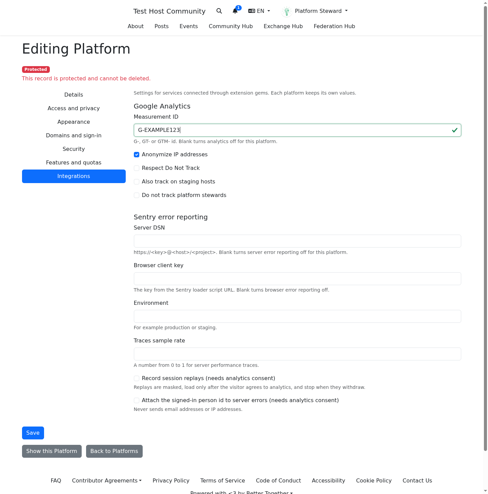
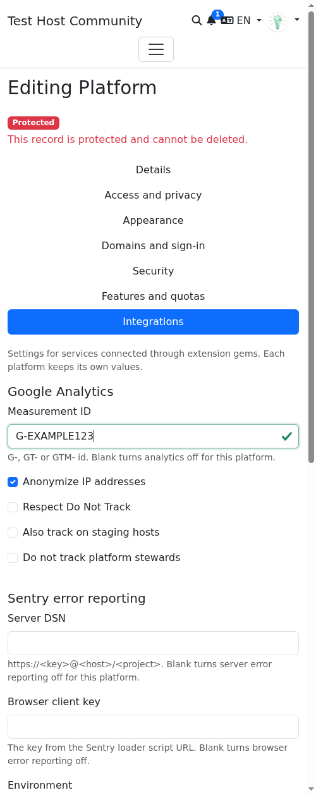

# Better Together Google Analytics

Adds Google Analytics 4 (`gtag.js`) to a [Community Engine](https://github.com/better-together-org/community-engine-rails) host app, with each platform using its own measurement ID and with visitor consent respected.

## What it is for

- **One analytics property per platform.** A host app can serve several platforms (for example a main site and hosted community sites). Each platform stewards enter their own Measurement ID; platforms without one send nothing.
- **Consent first.** The gem registers an `analytics` consent category and sets Google consent mode v2 (denied by default, updated from the visitor's choice). It also adds `_ga` cookies to the platform's cookie policy page, only where analytics is on.
- **Privacy options** per platform: anonymize IP, respect Do Not Track, skip staging hosts, skip platform stewards.
- **Share tracking.** It listens for Community Engine's `better_together:share` browser event so social shares are reported without analytics code in CE core.
- **No inline markup in the host app.** Replaces the hand-written GA partial that host apps used to carry.

## Where you configure it

Platform stewards open **Edit platform, Integrations**. The Google Analytics group appears there once the gem is installed (the Sentry group in the screenshot comes from [better_together-sentry](https://github.com/better-together-org/better_together-sentry)).



On a phone the same tab stacks into one column:



The screenshots use example values only.

## Requirements

- Community Engine `>= 0.11.0` with the platform Integrations tab (`BetterTogether.register_platform_setting`) and the consent system (`register_consent_provider`, `register_cookie_policy_segment`). On older engines the gem still loads but skips the parts the engine does not support.
- Ruby `>= 3.2`.

## Installing in a host app

1. Add the gem to the host app's `Gemfile`:

   ```ruby
   gem 'better_together-google-analytics', github: 'better-together-org/better_together-google-analytics', branch: 'main'
   ```

   Pin a `tag:` or `ref:` for production. While developing locally you can use `path: '../better_together-google-analytics'`.

2. Install and restart:

   ```bash
   bundle install
   ```

   There are no migrations and no generators. The gem registers itself when Rails boots.

3. Remove the old inline GA partial (`app/views/layouts/better_together/_custom_head_javascript.html.erb` or similar) if the app has one, otherwise the tag is sent twice.

4. Sign in as a platform steward, open **Edit platform, Integrations**, enter the Measurement ID (`G-`, `GT-` or `GTM-`) and save. Repeat per platform.

5. Check it: load a public page and confirm the `gtag/js?id=...` script is in the page head, then accept analytics in the consent banner and watch Realtime in Google Analytics. Without consent the page sends no hit.

### Upgrading an app that used `GTAG_ID`

`GTAG_ID` still works as a fallback for the **host platform only**; other platforms never inherit it. Move the value into the Integrations form when convenient and then remove the environment variable.

### Content Security Policy

The gem adds the Google origins (`googletagmanager.com`, `google-analytics.com`, `region1.google-analytics.com`) to the engine's CSP allow-list. Add them to a platform's own CSP settings only if that platform overrides the global policy.

## Consent and cookie policy

Needs a Community Engine with the consent system (`register_consent_provider`, `register_cookie_policy_segment`). The gem registers:

- A consent provider that asks for the `analytics` category only on platforms that have a measurement id. Platforms without one get no banner entry for Google Analytics.
- A cookie policy segment (category `analytics`) listing `_ga` and `_ga_<id>` (purpose, 2 years, provider Google, third party) with a link to Google's privacy page. It is shown only on platforms that have a measurement id (the host platform counts when `GTAG_ID` supplies one).
- Consent mode v2: `gtag('consent', 'default', denied)` first, then an `update` from the visitor's `bt_consent` cookie at page load (CE rewrites that cookie from a signed-in person's stored choice, and ignores it when the policy version changed), and again whenever the banner or the settings form fires `better_together:consent`. Withdrawing consent denies again without a reload. The old "wait for visitor consent" setting is gone: when consent is available it is always applied.

After upgrading, remove any inline GA partial (`_custom_head_javascript`) from the host app so the tag is not sent twice.

## Private pages are never measured

Needs a Community Engine with `third_party_tracking_allowed?` ([community-engine-rails#2237](https://github.com/better-together-org/community-engine-rails/pull/2237)). The gem renders nothing, and sends no page views, on pages Community Engine excludes: conversations and messages, notifications, settings and dashboards, sign-in and password flows, URLs that carry a token, error responses, non-public platforms and non-public records, plus any rule a host app registers with `BetterTogether.register_third_party_tracking_exclusion`.

Page views are sent by the gem, not by `gtag('config')`, so each Turbo visit is checked against the page's `bt-third-party-tracking` meta tag. Measurement is switched off the moment a visit starts and back on only when the new page allows it. Token query parameters (`invitation_code`, `token`, `reset_password_token` and similar) are removed from the reported address.

In Google Analytics, turn off **Enhanced measurement, Page changes based on browser history events**. The gem reports page views itself, and the browser Back button can still trigger Google's own history listener before the gem can switch it off. With older Community Engine versions the gem behaves as before (the check passes), apart from sending page views itself.

## Development

```bash
bundle exec rake test      # unit tests, no Community Engine needed
BETTER_TOGETHER_CE_LIB=/path/to/community-engine-rails/lib bundle exec rspec   # cookie policy specs
bundle exec rubocop
```

The rspec suite uses Community Engine's shared examples (`better_together/cookie_policy/rspec`) and skips when they are not on the load path.

Design notes are in `docs/per-platform-analytics.md`. Changes are recorded in `CHANGELOG.md`.

## License

LGPL-3.0-or-later, see `LICENSE`.
